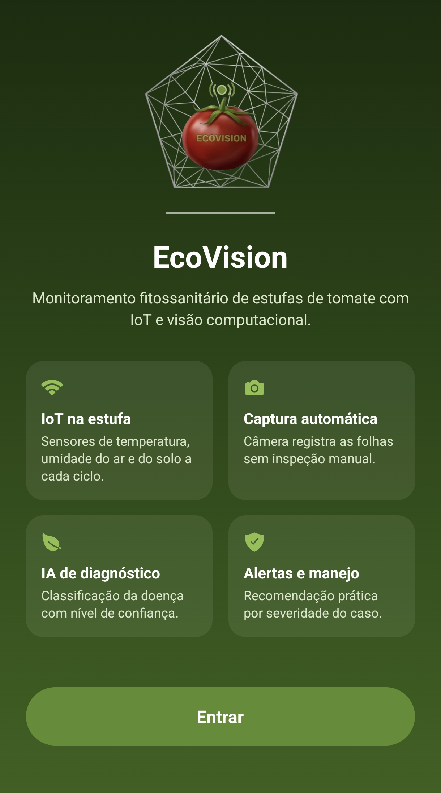
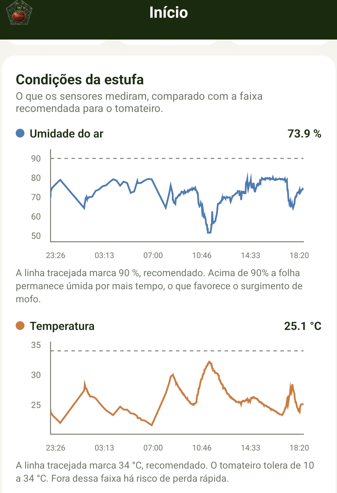
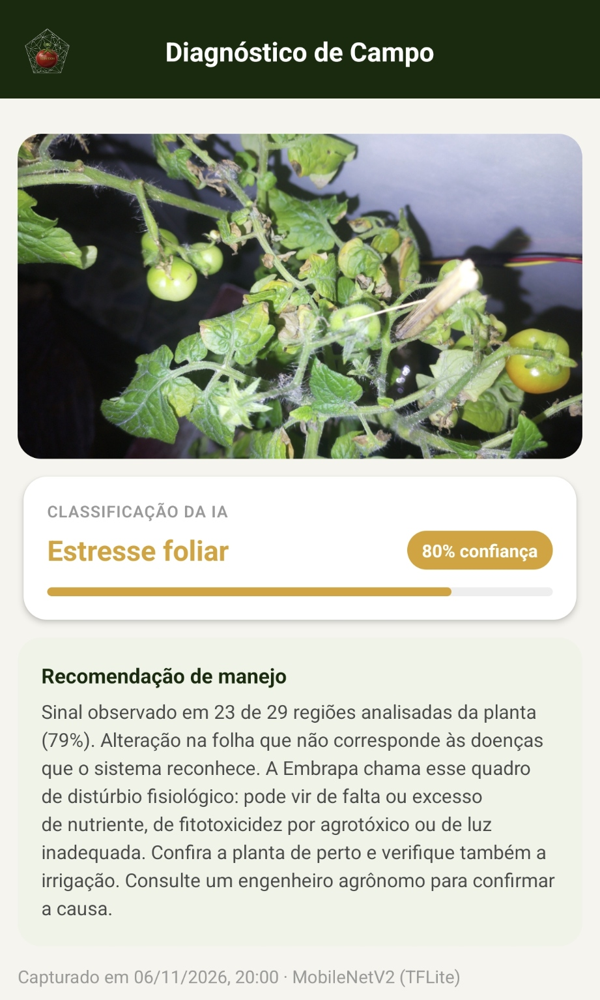
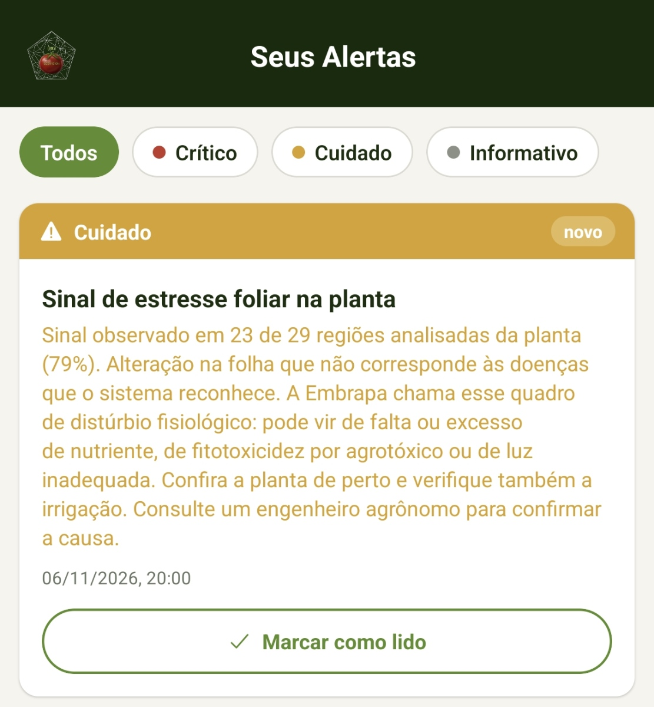
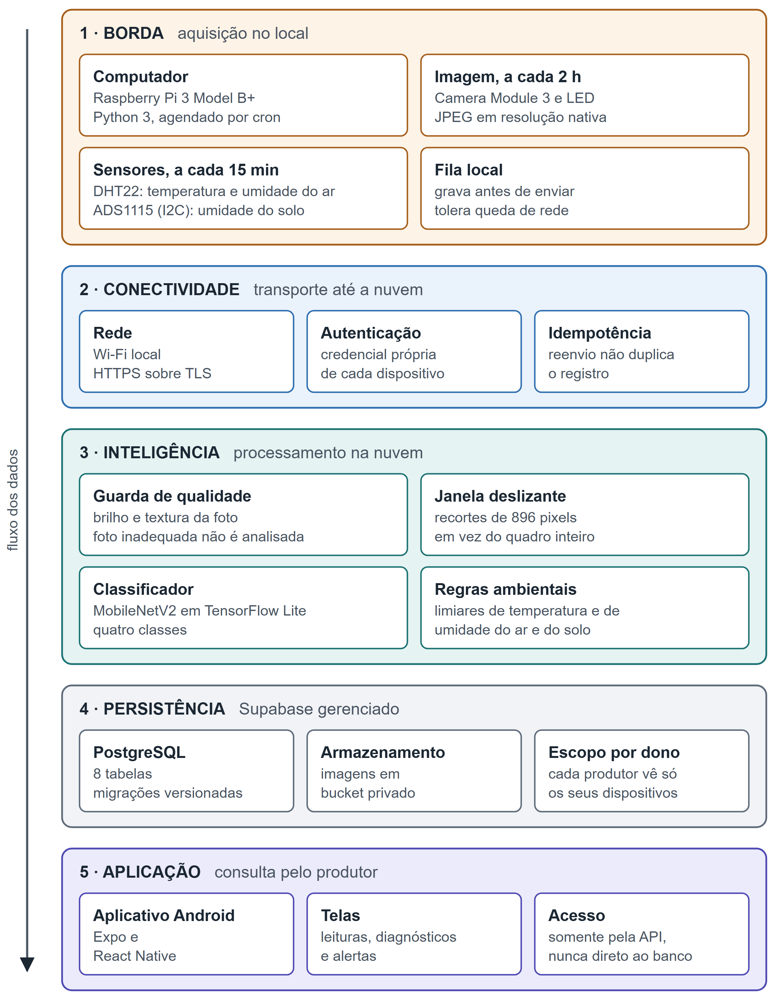

<h1 align="center">EcoVision</h1>

<p align="center">
  Monitoramento fitossanitário de estufas de tomateiro com Internet das Coisas e visão computacional
</p>

<p align="center">
  
  
  
  
  
  <a href="https://doi.org/10.5281/zenodo.23646357"></a>
</p>

<p align="center">
  
  
  
  
</p>

Um dispositivo instalado junto da planta fotografa as folhas e mede a
temperatura, a umidade do ar e a umidade do solo. As imagens são
classificadas em nuvem por uma rede neural convolucional, e o produtor
acompanha diagnósticos, leituras e alertas em um aplicativo Android.

## Sumário

- [Destaques](#destaques)
- [Arquitetura](#arquitetura)
- [Estrutura do repositório](#estrutura-do-repositório)
- [Início rápido](#início-rápido)
- [Resultados](#resultados)
- [Dados](#dados)
- [Testes](#testes)
- [Autores](#autores)
- [Licença](#licença)

## Destaques

- **Diagnóstico por janela deslizante.** A captura de 4608 × 2592 pixels é
  recortada em janelas de 896 pixels, e o diagnóstico é a classe mais
  severa presente em pelo menos 20% das janelas, o que mantém a folha na
  mesma escala em que o modelo foi treinado.
- **Classe de estresse foliar construída no próprio domínio.** Além de
  saudável, septoriose e pinta-preta, o modelo reconhece alterações
  abióticas da folha, a partir de 193 janelas rotuladas à mão nas capturas
  do dispositivo e publicadas no Zenodo.
- **Verificação de qualidade da imagem.** Capturas escuras ou sem textura
  são armazenadas sem diagnóstico, em vez de receberem um "saudável" com
  alta confiança.
- **Tolerância a quedas de rede.** Cada captura é gravada em uma fila local
  antes do envio e reenviada quando a conexão volta; reenvios não geram
  registros duplicados.
- **Segurança por dispositivo e por dono.** Cada aparelho tem credencial
  própria, e cada conta vê apenas os dispositivos que vinculou pelo código
  de pareamento.

## Arquitetura

<p align="center">
  
</p>

| Camada | Implementação |
|---|---|
| Borda | Raspberry Pi 3 Model B+ com Camera Module 3, LED, DHT22 e sensor de solo com ADS1115; leituras a cada 15 minutos e foto a cada 2 horas |
| Conectividade | Wi-Fi e HTTPS, credencial por dispositivo, chave de idempotência |
| Inteligência | API FastAPI no Railway: verificação de qualidade, janelas e classificação com MobileNetV2 em TensorFlow Lite; regras de limiar ambiental |
| Persistência | PostgreSQL e Supabase Storage, com bucket privado e URLs assinadas |
| Interface | Aplicativo Android em Expo e React Native, com acesso somente pela API |

O modelo é treinado fora desse fluxo, na pasta `ml/`, e chega à API como
um arquivo `.tflite` versionado no repositório.

## Estrutura do repositório

| Pasta | Conteúdo |
|---|---|
| [`app/`](app/README.md) | Aplicativo Android (Expo, React Native, TypeScript) |
| [`cloud/`](cloud/README.md) | API, banco de dados, migrações e testes |
| [`edge/`](edge/README.md) | Software do Raspberry Pi, lista de materiais e pinagem |
| [`ml/`](ml/README.md) | Treinamento, avaliação e modelos exportados |
| [`infra/`](infra/) | Modelos de variáveis de ambiente e políticas do Storage |
| [`docs/figuras/`](docs/figuras/README.md) | Diagramas, esquemático, resultados e telas |

## Início rápido

**API**

```bash
cd cloud
pip install -r requirements.txt
cp ../infra/env/cloud.env.example .env    # preencher as variáveis
alembic upgrade head
uvicorn app.main:app --reload
```

**Aplicativo**

```bash
cd app
npm install
cp .env.example .env                      # definir EXPO_PUBLIC_API_URL
npx expo start
```

**Dispositivo** (Raspberry Pi OS Lite, 64 bits)

```bash
bash edge/scripts/install.sh              # dependências, ambiente virtual e cron
# em seguida, preencher edge/.env com API_BASE_URL, DEVICE_ID e DEVICE_API_KEY
```

Os detalhes de cada camada, incluindo a implantação no Railway e a
calibração dos sensores, estão nos READMEs das pastas.

## Resultados

| Avaliação | Resultado |
|---|---|
| Modelo de três classes, imagens de laboratório (PlantVillage, 300 imagens) | 94,3% de acurácia |
| Modelo de três classes, imagens de campo (PlantDoc, 27 imagens) | 74,1% de acurácia |
| Modelo em produção, enquadramento do próprio dispositivo retido do treino (18 janelas) | 94,4% de acurácia, contra 55,6% da baseline trivial |
| Diagnóstico de uma captura completa, em computador de desenvolvimento | 654 ms no percentil 95 |

O protocolo de avaliação e as demais métricas estão em
[`ml/README.md`](ml/README.md).

## Dados

As capturas do dispositivo, as leituras ambientais e as janelas rotuladas
estão publicadas no Zenodo, sob a licença CC BY 4.0:

> OLIVEIRA, A. C. de et al. **EcoVision**: imagens de folhas de tomateiro e
> leituras ambientais para monitoramento fitossanitário em estufa. Zenodo,
> 2026. DOI: [10.5281/zenodo.23646357](https://doi.org/10.5281/zenodo.23646357).

## Testes

| Camada | Testes | Execução |
|---|---|---|
| API | 210 | `cd cloud && pytest -q` |
| Dispositivo | 32 (8 exigem Linux) | `python -m pytest edge/tests -q` |
| Aplicativo | verificação de tipos | `cd app && npx tsc --noEmit` |

Os testes da API e do dispositivo rodam no GitHub Actions a cada push, e a
implantação no Railway aguarda a aprovação deles.

## Autores

Amanda Camille de Oliveira, Higor Pereira dos Santos, Igor Rodrigues
Alves e João Paulo Magalhães, sob orientação da Prof.ª M.ª Stephany
Mendes Oliveira. Trabalho de conclusão de curso de Ciência da Computação
da Universidade Paulista (UNIP), 2026.

## Licença

Todos os direitos reservados. Consulte o arquivo [LICENSE](LICENSE). O
conjunto de dados publicado no Zenodo tem licença própria (CC BY 4.0).
