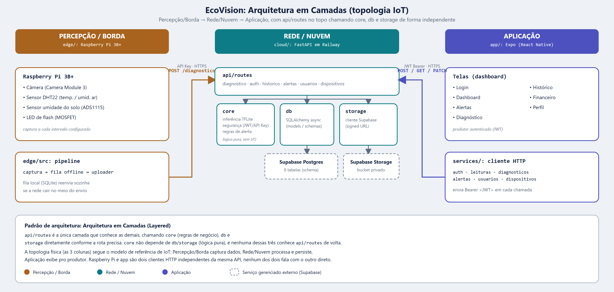

# Referência rápida: Tech Stack Blueprint Consolidado v3.0

> **Leia primeiro o [Blueprint v4.0](blueprint-v4.md).** Ele descreve o
> sistema como ele é hoje, implantado, e é o documento de consulta do
> projeto. Este arquivo continua sendo o índice do v3.0, que descreve o
> sistema **como foi planejado** e segue útil como registro histórico.
> Onde os dois divergem, vale o v4.0, e a seção 0 dele explica cada
> divergência.

Este arquivo é um índice de navegação para o documento externo
"EcoVision: Tech Stack Blueprint Consolidado, TC2, v3.0" (mantido na
pasta compartilhada do grupo, ver README raiz). O conteúdo completo NÃO
é duplicado aqui, apenas o mapa de onde encontrar cada decisão.

| Seção do Blueprint | Assunto | Pasta correspondente no repo |
|---|---|---|
| Fase 1: BoM | Lista de compras de hardware, MOSFET, câmera | `docs/decisions/0001-camera-module-3.md` |
| Fase 2: Software de Borda | Captura, sensores, fila offline | `edge/` |
| Fase 3: Pipeline de IA | Frankenstein Cirúrgico, split 70/15/15, metas de F1 | `ml/` |
| Fase 4: Nuvem, Backend e BD | Railway, Supabase, autenticação, regras de código | `cloud/`, `infra/` |
| Fase 4.3 | Autenticação (API Key + JWT/bcrypt). **A parte do dispositivo foi superada:** hoje é credencial por dispositivo | `docs/decisions/0003-autenticacao-dual.md`, `0009-credencial-por-dispositivo.md`, `0010-cadastro-aberto-e-rbac.md` |
| Fase 4.6 | Calendário de sincronização Railway × banca | `infra/calendar/sincronizacao.md` |
| Fase 5: Frontend | Framework decidido: Expo (React Native) | `docs/decisions/0002-frontend-framework-pendente.md`, `app/` |
| Plano de Execução | Ordem de fases e sprints | (não replicado, ver documento original) |

## Diagrama de arquitetura

Padrão declarado: **Arquitetura em Camadas (Layered)**. A topologia
física segue o modelo de referência de IoT em 3 camadas (percepção/
borda, rede/nuvem, aplicação). Dentro da camada de nuvem (`cloud/`),
`api/routes` é a única camada que conhece as demais: cada rota chama
`core` (regras de negócio puras, sem I/O), `db` e `storage` diretamente
conforme a necessidade, sem passar por uma cadeia fixa. `core` não
depende de `db` nem de `storage`, e nenhuma dessas três camadas conhece
`api/routes` de volta, o que preserva a regra de dependência unidirecional
da Arquitetura em Camadas (checado direto nos imports do código em
2026-09-20, não é só teoria de diagrama).

Padrões como Event-Driven, Space-Based ou CQRS + Event Sourcing (às
vezes recomendados de forma genérica para cenários de IoT) não se
encaixam aqui: o dispositivo não opera em tempo real, captura a cada
intervalo fixo (2h) e manda uma requisição HTTP isolada por vez, sem
volume de eventos concorrentes nem necessidade de replay/auditoria de
eventos que justificasse a complexidade extra desses padrões. Isso foi
conferido contra o material de referência da disciplina:
- [O que é EDA (AWS)](https://aws.amazon.com/pt/what-is/eda/): a própria
  AWS lista como público-alvo da EDA workloads com tráfego variável/em
  picos e processamento sob demanda no lugar de lotes periódicos, o
  oposto do nosso caso (captura em lote a cada 2h).
- [Arquitetura de referência de Data Analytics Serverless (AWS)](https://aws.amazon.com/pt/blogs/aws-brasil/aws-serverless-data-analytics-arquitetura-de-referencia/):
  mesmo a própria AWS descreve seu pipeline de dados de referência como
  "arquitetura em camadas orientada a componentes", não como EDA, mesmo
  tendo gatilhos por evento em uma das camadas.
- [CQRS na AWS com Amazon SQS](https://aws.amazon.com/pt/blogs/aws-brasil/cqrs-na-aws-sincronizando-os-servicos-de-command-e-query-com-o-amazon-sqs/):
  o próprio autor da AWS afirma que separar em dois serviços/bancos "só
  compensa quando precisamos de escalabilidades diferentes ou bancos de
  dados diferentes para atender a comandos e consultas", nenhum dos
  quais é o caso do EcoVision (leitura e escrita de baixo volume, mesmo
  banco).

Fonte editável: `diagramas/arquitetura-em-camadas.svg`.

## Status deste documento

Congelado como índice do v3.0. Decisão nova entra como ADR em
`docs/decisions/` e é refletida no [Blueprint v4.0](blueprint-v4.md),
não aqui.

O diagrama acima **continua correto e vigente**: a arquitetura em
camadas e a justificativa de por que não é EDA nem CQRS não mudaram
entre as duas versões. O v4.0 aponta para este arquivo justamente por
isso.
