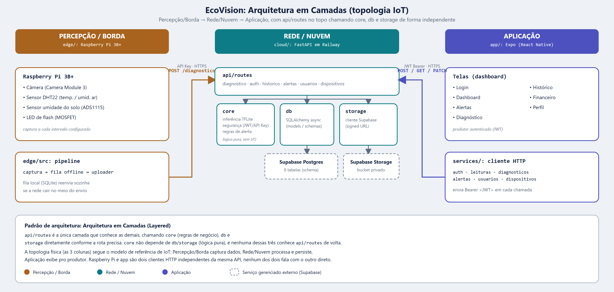

# EcoVision: Blueprint Consolidado v4.0

**Sistema de Monitoramento IoT e Visão Computacional para o Controle
Fitossanitário em Estufas de Tomate**

| | |
|---|---|
| **Versão** | 4.0 |
| **Data** | 2026-10-11 |
| **Substitui** | Tech Stack Blueprint Consolidado v3.0 (TC2) como documento de consulta |
| **Estado do sistema** | Em produção, com o dispositivo de campo em ajuste de instalação |

---

## 0. Para que serve este documento, e por que existe uma v4.0

O Blueprint v3.0 descreve o sistema **como foi planejado**. Este
documento descreve o sistema **como ele é**, depois de implantado.

A diferença entre os dois não é erro de planejamento: é o que acontece
quando um projeto encosta na realidade. Três premissas do v3.0 caíram em
contato com o mundo, e cada queda está registrada como ADR:

| Premissa do v3.0 | O que aconteceu | Onde está registrado |
|---|---|---|
| "Existe 1 único dispositivo, então uma API Key global basta" | O cadastro de produtores foi aberto, e chave global passou a significar que qualquer um poderia injetar diagnóstico falso na estufa alheia | [ADR 0009](../decisions/0009-credencial-por-dispositivo.md) |
| "Classificador de 10 classes do PlantVillage" | O modelo treinado e validado reconhece 3, e publicar 10 com 7 chutando produziria recomendação errada de defensivo | [ADR 0011](../decisions/0011-escopo-de-tres-classes.md) |
| "SMTP para enviar e-mail" | O Railway bloqueia as portas de e-mail no plano contratado, e o cadastro estourava o timeout do app | [ADR 0013](../decisions/0013-email-transacional-brevo.md) |

Onde este documento divergir do v3.0, vale este. O v3.0 continua válido
como registro histórico, e o índice por seção dele está em
[`blueprint-reference.md`](blueprint-reference.md).

**Como ler, por papel:**

- Quem vai à banca: seções 1, 2, 7, 9 e 10.
- Quem vai mexer no código: a seção da camada correspondente (3 a 6)
  mais a seção 8 (armadilhas).
- Quem vai escrever o TCC: seções 2, 7, 9, 10 e o índice de ADRs.

---

## 1. O que o sistema faz, em uma página

Um Raspberry Pi dentro da estufa fotografa folhas de tomateiro a cada
duas horas, lê temperatura, umidade do ar e umidade do solo, e envia
tudo para uma API na nuvem. A API classifica a folha com um modelo de
visão computacional, guarda a imagem e os dados, e gera alerta quando
encontra doença ou quando as condições ambientais favorecem uma. O
produtor acompanha pelo celular.

**O que o sistema deliberadamente NÃO faz:**

- Não roda IA no dispositivo. A inferência é na nuvem por decisão de
  arquitetura, não por limitação do hardware (o Pi 3B+ daria conta).
- Não avisa com o aplicativo fechado ([ADR 0012](../decisions/0012-notificacao-local-sem-push.md)).
- Não reconhece as dez doenças do catálogo, só três, e diz isso ao
  produtor na própria tela ([ADR 0011](../decisions/0011-escopo-de-tres-classes.md)).
- Não aciona irrigação nem qualquer atuador de cultivo. O Ring LED é o
  único atuador, e serve para iluminar a foto.

**Endereços em produção:**

| Componente | Onde |
|---|---|
| API | `https://ecovision-production.up.railway.app` |
| Banco e Storage | Supabase (Postgres + bucket privado `ecovision-imagens`) |
| Aplicativo | APK Android com atualização pelo canal `preview` do EAS Update |
| Dispositivo | `pi-estufa-01` |

---

## 2. Arquitetura

### 2.1. Padrão declarado

**Arquitetura em Camadas (Layered)**, sobre a topologia de referência de
IoT em três camadas: percepção/borda, rede/nuvem, aplicação.



Fonte editável: `diagramas/arquitetura-em-camadas.svg`.

A justificativa de por que **não** é Event-Driven, Space-Based ou
CQRS, com as fontes conferidas, está em
[`blueprint-reference.md`](blueprint-reference.md#diagrama-de-arquitetura).
Resumo: o dispositivo captura em lote a cada duas horas e manda uma
requisição isolada por vez. Não há volume de eventos concorrentes nem
necessidade de replay que pagasse a complexidade.

### 2.2. Fluxo de dados completo

```
   ESTUFA                          NUVEM                        PRODUTOR
   ──────                          ─────                        ────────

┌──────────────┐              ┌─────────────────┐           ┌──────────────┐
│ edge/        │              │ cloud/          │           │ app/         │
│ Raspberry Pi │  POST        │ FastAPI         │   GET     │ Expo /       │
│ 3 Model B+   │  /diagnostico│ no Railway      │  (JWT)    │ React Native │
│              │ ────────────▶│                 │◀──────────│              │
│ Camera Mod 3 │  imagem +    │ 1 worker        │           │ Android      │
│ DHT22        │  leituras +  │ TFLite em RAM   │           │              │
│ solo/ADS1115 │  credencial  │ nada em disco   │           └──────────────┘
│ Ring LED     │  do aparelho └────────┬────────┘                  ▲
│              │                       │                           │
│ fila offline │                       │ grava                     │
│ (JSON Lines) │                       ▼                           │
└──────────────┘              ┌─────────────────┐                  │
                              │ Supabase        │                  │
     ▲                        │ Postgres (dados)│──────────────────┘
     │                        │ Storage (fotos, │   somente através
  cron 2h                     │ bucket privado) │   da API, nunca
  cron 15min (fila)           └─────────────────┘   direto
```

**Regra que atravessa tudo:** o aplicativo **nunca** fala com o Supabase
diretamente. A imagem chega como signed URL já pronta na resposta da
API. Isso mantém a credencial do Storage fora do celular e permite trocar
o provedor de armazenamento sem tocar no app.

O modelo de IA é treinado **offline** na camada `ml/` (Google Colab) e
chega ao Railway versionado no Git, nunca por upload manual.

### 2.3. Camadas internas do backend, e a regra de dependência

```
api/routes/  ──────▶ core/      (regras puras, sem I/O)
     │       ──────▶ db/        (SQLAlchemy async)
     │       ──────▶ storage/   (Supabase Storage)
     │
     └──────▶ api/escopo.py, api/dispositivo_auth.py
              (precisam do banco, por isso NÃO moram em core/)
```

`core/` **não importa** `db/` nem `storage/`, e nenhuma das três conhece
`api/routes/` de volta. Isso foi conferido nos imports do código, não é
só desenho.

A consequência prática é o que torna a regra valiosa: limiar ambiental,
força de senha, decisão de inatividade de dispositivo e pré-processamento
de imagem são **funções puras, testáveis sem banco nenhum**. Por isso
`escopo.py` e `dispositivo_auth.py` ficaram em `api/` e não em `core/`,
ainda que conceitualmente pareçam regra de negócio: eles consultam o
banco, e deixá-los em `core/` romperia a regra.

---

## 3. Camada de borda (`edge/`)

### 3.1. Hardware

| Componente | Peça | Decisão |
|---|---|---|
| Computador | Raspberry Pi 3 Model B+ (Anatel), quad-core Cortex-A53 1.4GHz, 1GB RAM | [ADR 0004](../decisions/0004-raspberry-pi-3b-plus.md), troca em relação ao Pi Zero 2 W |
| Câmera | Camera Module 3, autofoco PDAF | [ADR 0001](../decisions/0001-camera-module-3.md) |
| Ar | DHT22 (temperatura e umidade) | |
| Solo | Sensor capacitivo via ADS1115 (ADC I2C) | Limiares em [ADR 0005](../decisions/0005-limiares-ambientais.md) |
| Iluminação | Ring LED acionado por **MOSFET de canal N** | **Nunca ligar o LED direto no GPIO**: correção crítica do Blueprint, Fase 1 |

### 3.2. Responsabilidades e agendamento

Captura, compressão e transmissão. **Nenhuma inferência roda aqui.**

| Tarefa | Frequência | Mecanismo |
|---|---|---|
| Captura (sensores, LED, foto, fila, upload) | a cada 2h | `cron` |
| Drenagem da fila offline | a cada 15min | `cron` |

Compressão: Pillow com libjpeg-turbo, `quality=70`, resultando em 150 a
250 KB por foto.

**Fila offline (JSON Lines com lock de arquivo via `fcntl`):** é o que
torna o sistema utilizável numa estufa de verdade. Quando a rede cai, a
captura continua e fica guardada no cartão SD; quando volta, o uploader
drena com retry e backoff. Já foi validada em produção: uma leitura de
DHT22 (29,5 °C, 63%) sobreviveu na fila e chegou ao banco depois.

É também a premissa do [ADR 0008](../decisions/0008-deteccao-dispositivo-inativo.md):
o alerta de dispositivo inativo só dispara depois de **duas** janelas de
captura perdidas, justamente porque a fila resolve sozinha as quedas
curtas, e alertar no primeiro ciclo geraria alarme falso.

### 3.3. Sensor que falha não cancela a captura

Se o DHT22 ou o sensor de solo falharem, `edge/src/main.py` grava `None`
naquele campo e segue o ciclo. Perder a foto por causa de um sensor
instável seria pior do que registrar a medição faltando.

Isso tem consequência obrigatória nas camadas acima: as três medições
são opcionais no schema, e **o app tem que exibir ausência de leitura,
nunca zero**. "0% de umidade do solo" é um valor válido e alarmante;
"sem medição" é a verdade.

### 3.4. Estado atual

O Pi está na estufa com `DEVICE_ID=pi-estufa-01` e credencial própria,
mas **a captura automática está desativada** (linha do cron comentada,
com nota datada) enquanto a fiação é ajustada. Enquanto isso, as telas
de diagnóstico aparecem vazias, que é o comportamento correto.

---

## 4. Camada de nuvem (`cloud/`)

A lista completa de endpoints, garantias e schema está em
[`cloud/README.md`](../../cloud/README.md). Aqui ficam só as decisões de
arquitetura.

### 4.1. Cinco regras não negociáveis

1. Modelo `.tflite` versionado no Git, nunca em volume do Railway.
2. Processamento de imagem 100% em memória: **nenhum `open()` de escrita**
   no pipeline de inferência.
3. Log em `stdout`, nunca em disco.
4. A imagem é gravada no Supabase Storage **antes** de ser descartada da RAM.
5. Apenas `tflite-runtime` ou `ai-edge-litert` em produção, **nunca** o
   `tensorflow` completo: estoura a RAM do Railway.

### 4.2. Uma sexta regra, que é a mesma decisão três vezes

**1 único worker no Uvicorn.** O interpretador TFLite é carregado por
processo, e um segundo worker dobraria o consumo de memória.

Essa restrição aparece em três decisões aparentemente independentes, e
vale notar que são a mesma:

| Decisão | Consequência da restrição |
|---|---|
| [ADR 0008](../decisions/0008-deteccao-dispositivo-inativo.md) | O alerta de dispositivo inativo é calculado sob demanda, não por job em background |
| [ADR 0012](../decisions/0012-notificacao-local-sem-push.md) | Não há push de servidor, porque não há processo observando alertas novos |
| [ADR 0014](../decisions/0014-deploy-railway-e-gate-de-ci.md) | As migrations rodam no start command, não em processo separado |

### 4.3. Degradação em vez de queda

Dependência externa ausente **degrada o comportamento e registra erro no
log**, nunca derruba o sistema:

| Falta | Comportamento |
|---|---|
| Modelo `.tflite` | Inferência devolve `classe: "indisponivel"`, a captura é gravada normalmente |
| Serviço de e-mail | A conta nasce **já verificada**, com erro no log |
| Signed URL de uma imagem | Aquele item vem com `url_imagem: null`, a lista não quebra |
| Banco inacessível | `/health` responde 503, e o UptimeRobot avisa |

O caso do e-mail merece a justificativa explícita: criar a conta
bloqueada quando o e-mail não pode sair prenderia o produtor numa conta
que **ninguém** consegue confirmar. Entre "menos seguro" e
"inutilizável", a escolha foi a primeira, consciente e registrada.

### 4.4. O preço da degradação silenciosa, pago uma vez

Essa filosofia tem um custo, e ele foi cobrado: a API subiu em produção
**sem modelo**, devolvendo placeholder em toda captura, **sem nenhum
erro visível**. A causa era um caminho relativo resolvido a partir do
diretório de trabalho em vez da raiz do repositório.

Corrigido com `caminho_do_modelo` em `cloud/app/config.py`, mais um
teste de regressão. A lição é que degradar em silêncio exige que o log
seja alto, e por isso cada caminho de degradação acima grava `WARNING`
ou `ERROR`, nunca `INFO`.

---

## 5. Camada de IA (`ml/`)

### 5.1. O que está em produção

| | |
|---|---|
| Arquitetura | MobileNetV2, transfer learning |
| Artefato | `ml/models/modelo.tflite`, 8,9 MB, float32 |
| Classes | 3: `septoriose`, `pinta_preta`, `saudavel` (nesta ordem) |
| Quantização | **Nenhuma**, de propósito |
| Validação externa | Conjunto próprio em `ml/validacao_externa/`, com Grad-CAM antes e depois |
| Validação agronômica | Carlos validou a classe de septoriose |

Estratégia de dataset: **"Frankenstein Cirúrgico"**, fusão seletiva de
PlantVillage (sintético, com `rembg` aplicado só nas classes de baixo
risco de corrosão de segmentação) com o Mendeley Tomato Disease Dataset
(ambiente real). É um argumento de originalidade acadêmica defensável, e
a justificativa completa está em [`ml/README.md`](../../ml/README.md).

### 5.2. Três decisões medidas, não opinadas

**Sem quantização.** A versão quantizada ocupa 2,53 MB contra 8,90 MB,
mas **inverteu 2 de 7 predições** no conjunto de validação externa, com
diferença de até 29 pontos percentuais de confiança. A float32 divergiu
no máximo 0,0004 ponto percentual do Keras original. Economizar 6 MB não
paga mudar diagnóstico.

**Redimensionamento NEAREST.** Com `Image.Resampling.NEAREST`, 6 de 6
predições batem com o Keras. Com BILINEAR ou BICUBIC, **0 de 6**, e duas
classes mudam.

**Três classes, não dez.** `class_weight` e F1 ponderado mitigam
desequilíbrio de classes, não **ausência** de dado de treino. A classe
minoritária do PlantVillage ficaria com cerca de 45 imagens no teste, e
um F1 sobre 45 imagens não se defende.

### 5.3. Regra inviolável do dataset

**As imagens reais capturadas com o hardware do EcoVision NUNCA entram
no treino.** Elas são exclusivamente o conjunto de validação do mundo
real. É o que permite afirmar algo sobre desempenho em campo.

### 5.4. Dupla métrica

| Métrica | Mínimo para a banca | Ideal |
|---|---|---|
| Weighted F1 (validação sintética) | >= 75% | >= 82% |
| Weighted F1 (imagens reais do Pi) | >= 65% | >= 72% |
| Delta sintético contra real | documentar e explicar | < 10 p.p. |

O delta ainda **não foi medido**. É a principal pendência de IA, e
depende do João entregar os números.

---

## 6. Camada de aplicativo (`app/`)

Detalhe por tela em [`app/README.md`](../../app/README.md).

**Expo (React Native)**, [ADR 0002](../decisions/0002-frontend-framework-pendente.md).

A mudança estrutural de 2026-10-11: **as telas saíram dos mocks**. Antes
disso, o aplicativo mostrava temperatura real do sensor de um lado e
folha inventada do outro. Numa banca, um diagnóstico de uma folha que
nunca existiu ao lado de 29,5 °C medidos na estufa destrói a
credibilidade de todo o resto.

Único mock restante, por decisão de escopo: o **Financeiro**, que guarda
gastos em `AsyncStorage` local. Controle de gastos nunca foi parte do
escopo de monitoramento fitossanitário. Consequência assumida:
reinstalar o app apaga os dados, e outro aparelho na mesma conta não os
vê.

Camadas do app:

```
screens/   ──▶ services/  ──▶ api.ts  ──▶ API no Railway
     │              │
     │              └──▶ domain/doencas.ts  (vocabulário e escopo do modelo)
     └──▶ hooks/useCarregamentoAssincrono   (loading, erro, refresh)
```

Nenhuma tela decide o que é "saudável" nem traduz nome de classe: as
duas regras moram em `domain/doencas.ts`. Antes existiam **três cópias**
da mesma normalização de texto, em três arquivos, e três cópias da mesma
decisão divergem na primeira vez que alguém mexe em uma delas.

---

## 7. Segurança

O sistema tem duas pontas de autenticação, com mecanismos diferentes de
propósito ([ADR 0003](../decisions/0003-autenticacao-dual.md)).

### 7.1. Dispositivo: credencial própria e posse física

[ADR 0009](../decisions/0009-credencial-por-dispositivo.md)

Cada Pi tem o próprio segredo, cujo **hash bcrypt** fica em
`dispositivos.chave_hash`. O segredo em claro existe em dois lugares: na
saída do script de provisionamento, uma vez, e no `.env` daquele Pi.

A propriedade do aparelho é provada por **posse física**: o
provisionamento gera um código `ECO-XXXX-XXXX` para etiqueta, que o
produtor digita no app. O código só funciona enquanto o dispositivo não
tiver dono, e o alfabeto exclui `O`, `I`, `L`, `0` e `1`, que são os
caracteres mais confundidos ao ler de uma etiqueta.

### 7.2. Produtor: cadastro aberto, acesso fechado por posse

[ADR 0010](../decisions/0010-cadastro-aberto-e-rbac.md)

Qualquer pessoa cria conta. **O papel é sempre `produtor`**, ignorando o
que vier no corpo da requisição: sem essa imposição, bastaria mandar
`papel: "administrador"` no JSON para ver todas as estufas do sistema.

Uma conta nova **não vê absolutamente nada** até vincular um dispositivo.
Toda rota de consulta filtra pela cadeia de posse:

```
usuarios.id <- dispositivos.usuario_id
            (device_id) <- registros_imagem <- leituras/diagnosticos <- alertas
```

A distinção que mais importa nesse código: **lista vazia é diferente de
"sem filtro"**. Administrador recebe `None` (nenhum filtro); produtor sem
dispositivo recebe lista vazia (zero itens). Confundir os dois
entregaria o banco inteiro para qualquer conta recém-criada, e existe
teste para isso.

### 7.3. Seis proteções que parecem detalhe e não são

| Proteção | O que impede |
|---|---|
| Resposta idêntica para e-mail existente e inexistente | Descobrir quais e-mails têm conta |
| `HASH_DESCARTAVEL`: bcrypt roda mesmo sem conta | Descobrir contas **pelo tempo de resposta** (eram 0,39s contra 0,65s) |
| 404, não 403, em alerta de outro dono | Contar recursos do sistema testando ids |
| Trava de tentativas indexada pelo **e-mail digitado** | A própria trava virar detector de contas, pelo 429 |
| Código de e-mail guardado como hash e nunca devolvido pela API | Assumir conta olhando a resposta no inspetor do navegador |
| `compare_digest` em bytes, não em texto | Vazar credencial por timing, e derrubar a rota com um acento no header |

A segunda linha merece destaque porque a proteção era **só aparente**: a
mensagem de erro já era idêntica, mas o `or` em curto-circuito pulava o
bcrypt quando o e-mail não existia, e o cronômetro entregava a
informação que a mensagem escondia.

### 7.4. O que não está protegido, e está assumido

- A chave global do dispositivo ainda é aceita, num ramo de transição
  explícito, para não derrubar um Pi em campo no deploy. Cada uso grava
  aviso no log, e é assim que se descobre se ainda falta provisionar algum.
- As contas criadas antes da migration 0007 estão marcadas como
  verificadas sem nunca ter passado por confirmação. Intencional:
  bloqueá-las retroativamente trancaria as contas de teste do grupo.
- O remetente de e-mail é um Gmail enviando via Brevo, então a primeira
  mensagem tende a cair no spam. Resolver exigiria domínio próprio com
  SPF e DKIM.

---

## 8. Armadilhas conhecidas

Esta seção existe porque cada item abaixo **falhou em silêncio**: o
sistema respondia 200, a tela ficava bonita, e o resultado estava
errado. São as mais caras de encontrar e as mais fáceis de reintroduzir.

| # | Armadilha | Sintoma | Guarda |
|---|---|---|---|
| 1 | O modelo normaliza por dentro: espera pixels **crus de 0 a 255** | Dividir por 255 antes faz tudo virar "saudavel" com ~90% de confiança | Comentário em `inference.py` e no conversor, mais [ADR 0011](../decisions/0011-escopo-de-tres-classes.md) |
| 2 | Redimensionar com BILINEAR/BICUBIC | 0 de 6 predições batem com o Keras, duas classes mudam | Medido e documentado |
| 3 | `_CLASSES_DO_MODELO` fora de ordem após retreino | Cada predição sai com o nome e a recomendação de **outra doença** | Comentário no código e checklist de reativação no ADR 0011 |
| 4 | Caminho de modelo relativo ao diretório de trabalho | API sobe sem modelo e devolve placeholder sempre | `caminho_do_modelo` em `config.py` mais teste de regressão |
| 5 | `process.env[chave]` dinâmico no Expo | Variável vira `undefined` **só no build publicado**: funciona no Expo Go, quebra no APK | Acesso estático obrigatório em `src/config/env.ts` |
| 6 | Vocabulário de severidade divergente (`alta`/`media` contra `critico`/`cuidado`/`informativo`) | Tela quebra ao buscar a cor de uma severidade inexistente | Tradução com valor padrão em `services/alertas.ts` |
| 7 | Alerta sintético tem `id: null` | `null` como identificador faz todos os alertas sem id colidirem num só | Campo `chave` no app, e `sintetico` esconde o botão de "marcar como lido" |
| 8 | A suíte de testes lia o `.env` do desenvolvedor e **enviava e-mail de verdade** | Cota gasta e mensagens reais em caixas reais a cada execução | `conftest.py` força as variáveis de e-mail como vazias |
| 9 | Railway com root directory em `cloud/` | `ml/models/` desaparece do container e a inferência degrada sem erro | Monorepo compartilhado, ver [ADR 0014](../decisions/0014-deploy-railway-e-gate-de-ci.md) |
| 10 | Relógio do desenvolvedor adiantado | 401 inexplicável em token recém-emitido | `leeway=30` na validação do JWT |

---

## 9. Deploy, verificação e limites do plano

[ADR 0014](../decisions/0014-deploy-railway-e-gate-de-ci.md)

**Gate de CI:** o Railway publica com "Wait for CI" ligado, então código
com teste quebrado não chega a produção. Isso forçou remover o filtro
por pasta do workflow: com filtro, um push que mexesse só em `docs/` não
geraria check nenhum e o deploy esperaria para sempre por um resultado
que não viria. O custo é cerca de um minuto de CI em commit de
documentação; o benefício é que **todo** commit na `main` tem veredito.

**Como verificar antes de publicar:**

```bash
cd cloud && pytest -q      # 120 testes
cd app && npx tsc --noEmit # não há suíte de testes nesta camada
```

**Limites do plano Hobby, e como cada um foi contornado:**

| Limite | Contorno |
|---|---|
| Portas de SMTP bloqueadas | API HTTP do Brevo na porta 443 ([ADR 0013](../decisions/0013-email-transacional-brevo.md)) |
| RAM limitada | Sem `tensorflow`, 1 worker, imagem em `BytesIO` |
| Sem volume persistente | Imagem no Supabase Storage, log em `stdout` |
| Cota de 300 e-mails por dia (Brevo) | Intervalo mínimo de 60s no reenvio de código |

**iOS:** não existe build. Ninguém do grupo tem iPhone, e a demonstração
é Android mais Expo Go. Isso precisa estar escrito no TCC, não pendurado
como pendência.

---

## 10. Estado, pendências e o que dizer na banca

### 10.1. Pronto e verificado em produção

- Cadeia completa Pi → API → Supabase → aplicativo, com leitura real de
  sensor que sobreviveu à fila offline.
- Cadastro com confirmação por e-mail, reenvio de código e recuperação
  de senha, com o ciclo inteiro validado contra o ambiente real.
- Isolamento por dono, com teste de que uma conta nova não vê a estufa
  de ninguém.
- Modelo de 3 classes carregado e classificando, com equivalência medida
  contra o Keras original.
- Aplicativo Android instalado, consumindo **apenas** dado real (exceto
  o Financeiro, por decisão de escopo).

### 10.2. Pendências, por tipo

**Depende do hardware:** reativar o cron de captura depois do ajuste da
fiação, e recalibrar o limiar de umidade do solo com o sensor físico
([ADR 0005](../decisions/0005-limiares-ambientais.md)).

**Depende do grupo:** o João medir e documentar o gap entre F1 no
dataset e desempenho em foto de campo; o Igor consolidar as atas (hoje
`docs/atas/` está vazio) e corrigir as contradições do TC1 listadas em
[`docs/tcc/README.md`](../tcc/README.md); a Amanda aceitar o convite da
organização no Expo.

**Depende de uma sessão de teste:** exercitar o pareamento de
dispositivo pelo app com uma pessoa de verdade. O código existe e tem
teste automatizado, mas nenhum usuário passou pelo fluxo.

**Dívida técnica aceita:** remover o ramo de transição da chave global
quando todos os Pis estiverem provisionados.

### 10.3. As três perguntas difíceis, e as respostas

**"Por que a IA só reconhece três doenças, se o documento fala de dez?"**

Porque três classes validadas valem mais que dez chutando. O catálogo
agronômico das dez continua escrito e com fonte, esperando dado de
treino. E o limite está declarado dentro do aplicativo, na tela de
diagnóstico, não escondido: o produtor lê quais condições o sistema sabe
reconhecer. Um sistema que diz o que não sabe é mais confiável que um
que finge saber tudo.

**"Por que a inferência não roda no Raspberry Pi, que tem capacidade?"**

É decisão de arquitetura, não limitação. Manter a inferência na nuvem
permite trocar ou retreinar o modelo sem tocar em nenhum dispositivo em
campo, e mantém o Pi com uma responsabilidade só, que é capturar e
transmitir. O custo aceito é depender de rede, e a fila offline é
exatamente a mitigação desse custo.

**"O produtor é avisado se a estufa passar de 40 °C de madrugada?"**

Não, e isso está registrado como decisão, não como esquecimento
([ADR 0012](../decisions/0012-notificacao-local-sem-push.md)). A
notificação é disparada pelo próprio aparelho quando o app é aberto.
Push de servidor exigiria guardar token por usuário e um processo
observando alertas novos, o que contraria a decisão de 1 worker que
sustenta três outras partes do sistema. A seção 7 do ADR 0012 lista o
que seria necessário, e isso é trabalho futuro do TCC.

---

## 11. Índice de decisões

| ADR | Assunto |
|---|---|
| [0001](../decisions/0001-camera-module-3.md) | Camera Module 3, não V2 |
| [0002](../decisions/0002-frontend-framework-pendente.md) | Expo (React Native) |
| [0003](../decisions/0003-autenticacao-dual.md) | Autenticação dual (parte do dispositivo superada pelo 0009) |
| [0004](../decisions/0004-raspberry-pi-3b-plus.md) | Raspberry Pi 3 B+ |
| [0005](../decisions/0005-limiares-ambientais.md) | Limiares de risco ambiental |
| [0006](../decisions/0006-recomendacoes-por-diagnostico.md) | Recomendações de manejo por classe |
| [0007](../decisions/0007-divisao-equipe-final.md) | Divisão de tarefas da equipe |
| [0008](../decisions/0008-deteccao-dispositivo-inativo.md) | Detecção de dispositivo inativo |
| [0009](../decisions/0009-credencial-por-dispositivo.md) | Credencial por dispositivo e pareamento |
| [0010](../decisions/0010-cadastro-aberto-e-rbac.md) | Cadastro aberto, RBAC por posse, confirmação por e-mail |
| [0011](../decisions/0011-escopo-de-tres-classes.md) | Escopo do modelo em três classes |
| [0012](../decisions/0012-notificacao-local-sem-push.md) | Notificação local, sem push de servidor |
| [0013](../decisions/0013-email-transacional-brevo.md) | E-mail pela API HTTP do Brevo |
| [0014](../decisions/0014-deploy-railway-e-gate-de-ci.md) | Deploy no Railway com gate de CI |

## 12. Referências

**Agronômicas** (fontes de cada limiar e recomendação, detalhadas nos
ADRs 0005 e 0006):

- Embrapa Hortaliças, "Tomate de mesa: Clima".
  <https://www.embrapa.br/web/hortalicas/tomate-de-mesa/clima>
- Embrapa Hortaliças, fichas de doenças do tomateiro (requeima, pinta
  preta, septoriose, mancha bacteriana, mofo de folha, mancha alvo,
  viroses).
- Validação de classe por agrônomo (Carlos), 2026-10-10.

**Datasets:**

- PlantVillage (imagens sintéticas, fundo controlado).
- Mendeley Tomato Disease Dataset (imagens em ambiente real).

**Arquitetura e plataforma:**

- Railway: monorepo compartilhado, "Wait for CI", bloqueio de portas de SMTP.
- Supabase: Session pooler para IPv4, políticas de bucket privado.
- Expo: EAS Build, EAS Update, inlining de `EXPO_PUBLIC_*` pelo Metro.
- Material de referência de padrões arquiteturais (AWS, sobre EDA e
  CQRS), citado em [`blueprint-reference.md`](blueprint-reference.md).

**Documentos internos:** `docs/decisions/` (ADRs),
`infra/supabase/storage_policies.md`, `cloud/tests/README.md`,
`edge/tests/README.md`, e o Blueprint v3.0 na pasta compartilhada do
grupo.

---

## 13. Manutenção deste documento

Uma decisão de arquitetura nova entra primeiro como **ADR** em
`docs/decisions/`, e só depois é refletida aqui. Este documento é o mapa;
os ADRs são o território.

Quando uma decisão for superada, **não apague o ADR antigo**: dê status
de superado e aponte para o substituto. O ADR 0003 é o exemplo, e o
motivo de ele ter caducado é em si um dos melhores argumentos de banca
que o projeto tem, porque mostra uma premissa sendo revista por evidência
em vez de por preferência.
